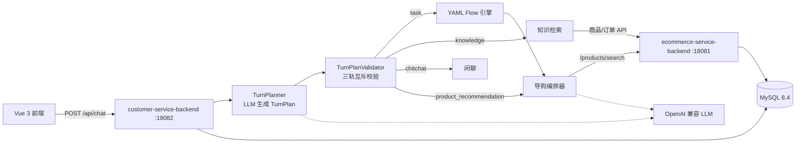
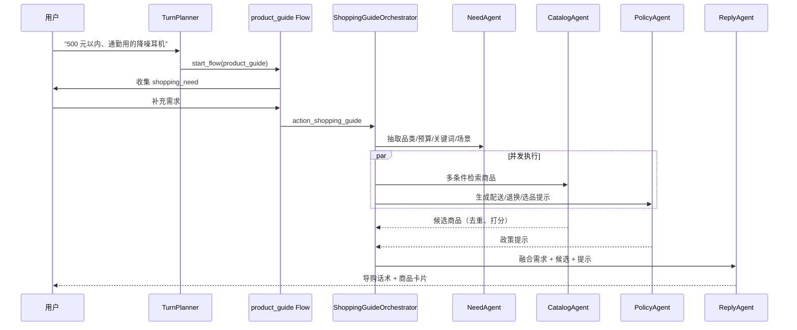

# 电商小二 · 智能导购客服

一个可运行的电商智能客服示例：既能查订单、查物流、提交退款，也能理解“想买什么、预算多少、什么场景”，并发调用多个专家 Agent 给出带商品卡片的导购推荐。

- 对话编排：`FastAPI + LangChain LCEL`
- 流程引擎：YAML 定义业务 Flow，支持槽位收集、条件跳转、任务暂停/恢复
- 导购：需求解析 → 并发检索/政策 → 打分排序 → 话术合成的多智能体编排
- 前端：`Vue 3 + Vite`，商品/订单以卡片形式返回

## 能力概览

| 轨道 | 说明 | 入口 |
| --- | --- | --- |
| Task | 订单状态、物流跟踪、退款申请、导购流程 | `flow_config/user_flows.yml` |
| Knowledge | 商品信息、订单信息、售后/配送/平台规则咨询 | `atguigu/knowledge` |
| Chitchat | 闲聊与兜底 | `atguigu/chitchat` |
| Guide | 导购推荐（多智能体并发） | `atguigu/guide` + `product_guide` flow |

## 整体架构



`DialogueEngine` 本身无 I/O，只接收消息与状态、推进流程；会话状态由 `DialogueService` 加载和持久化。

## 导购功能流程



两条触发路径都能进入导购：

1. **流程式**：`product_guide` 流程先问清需求，再由 `action_shopping_guide` 执行；
2. **问答式**：用户直接说“推荐个……”，`TurnPlanner` 选中 `product_recommendation` 意图，`KnowledgeHandler` 直接交给导购编排器。

## 多智能体并发实现

| Agent | 职责 | 执行方式 | 超时 | 失败降级 |
| --- | --- | --- | --- | --- |
| `NeedAgent` | LLM 抽取品类、预算、关键词、场景 | 首先执行 | 12s | 规则解析 |
| `CatalogAgent` | 把需求拆成 3~5 个检索条件，并发查商品 | 与 `PolicyAgent` 并发；内部子查询再并发 | 8s | 返回空目录 |
| `PolicyAgent` | 配送、退换、品类选购提示 | 与 `CatalogAgent` 并发 | 3s | 空提示 |
| `ReplyAgent` | 合成自然语言导购话术 | 最后执行 | 15s | 模板化回复 |

关键代码在 `customer-service-backend/atguigu/guide/orchestrator.py`：

```python
catalog_result, policy_result = await asyncio.gather(
    self._run_agent("catalog", self.catalog_agent.search(need), 8.0, []),
    self._run_agent("policy", self.policy_agent.advice(need), 3.0, PolicyAdvice()),
)
```

`CatalogAgent` 内部同样并发：

```python
results = await asyncio.gather(
    *(self._search_one(query) for query in queries),
    return_exceptions=True,
)
```

并发之外还做了三件事：

- **失败隔离**：每个 Agent 由 `asyncio.wait_for` 包裹，超时或异常只降级自己，不阻塞整轮；
- **结果融合**：按 `product_id` 去重，保留最高分候选；关键词命中、预算匹配、有货状态共同打分；
- **可观测**：每个 Agent 输出 `status/cost_ms` 日志，便于定位慢点。

## 目录结构

```text
ecommerce-customer-service/
├── customer-service-backend/      # 对话服务 :18082
│   ├── atguigu/
│   │   ├── api/                   # /api/chat、/api/chat/history
│   │   ├── engine/                # 无状态对话引擎
│   │   ├── planning/              # TurnPlan 生成、校验、澄清
│   │   ├── task/                  # YAML 流程引擎 + 动作注册
│   │   ├── knowledge/             # 商品/订单/FAQ/RAG 知识源
│   │   └── guide/                 # 导购多智能体（需求/目录/政策/话术）
│   └── flow_config/               # 业务 Flow 与槽位定义
├── ecommerce-service-backend/     # 电商业务服务 :18081
├── customer-service-frontend/     # Vue 3 前端 :5173
└── docker/                        # MySQL 8.4 + 初始化数据
```

## 快速开始

### 1. 启动 MySQL

```bash
cd docker
docker compose up -d
```

首次启动会自动创建 `customer_service` 和 `commerce` 两个库并写入演示数据。

### 2. 启动电商业务服务（:18081）

```bash
cd ecommerce-service-backend
uv sync
uv run uvicorn app.app:app --host 127.0.0.1 --port 18081 --reload
```

### 3. 启动对话服务（:18082）

```bash
cd customer-service-backend
cp .env.example .env        # 填入 LLM_API_KEY 等配置
uv sync
uv run uvicorn atguigu.api.app:app --host 127.0.0.1 --port 18082 --reload
```

### 4. 启动前端（:5173）

```bash
cd customer-service-frontend
npm install
npm run dev
```

打开 `http://127.0.0.1:5173`，发送：

> 500 元以内、通勤用的降噪耳机

演示数据商品较少，也可以试试 `iPhone`、`电热水壶`、`暖宝宝`、`手表` 等关键词。

## 主要接口

```http
POST /api/chat
{
  "sender_id": "u1001",
  "text": "推荐一款 3000 元以内的手表"
}

GET /api/chat/history?sender_id=u1001
```

电商服务新增导购检索接口：

```http
GET /products/search?keyword=手表&category=&min_price=100&max_price=500&limit=5
```

## 配置说明

- `customer-service-backend/.env`：LLM、MySQL、电商服务地址，已加入 `.gitignore`，模板见 `.env.example`；
- `ecommerce-service-backend/.env.example`：电商服务数据库配置；
- 导购超时可在 `atguigu/guide/orchestrator.py` 顶部常量调整。

## 技术栈

`Python 3.12` · `FastAPI` · `SQLAlchemy 2 (async)` · `LangChain LCEL` · `MySQL 8.4` · `Vue 3` · `Vite 6` · `uv`
